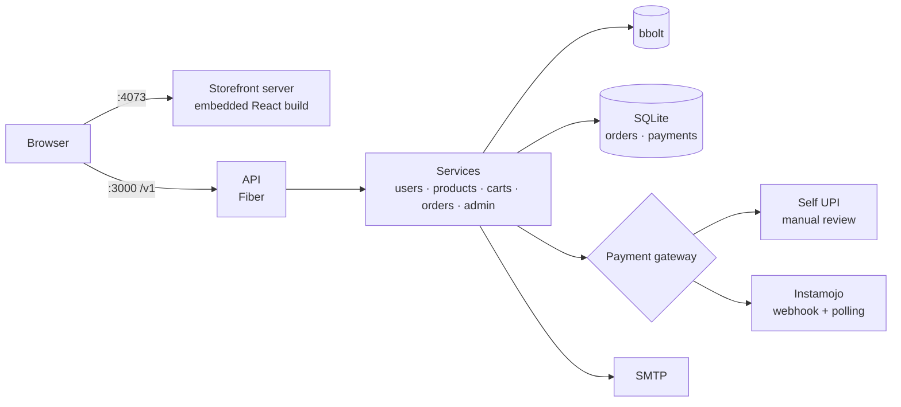
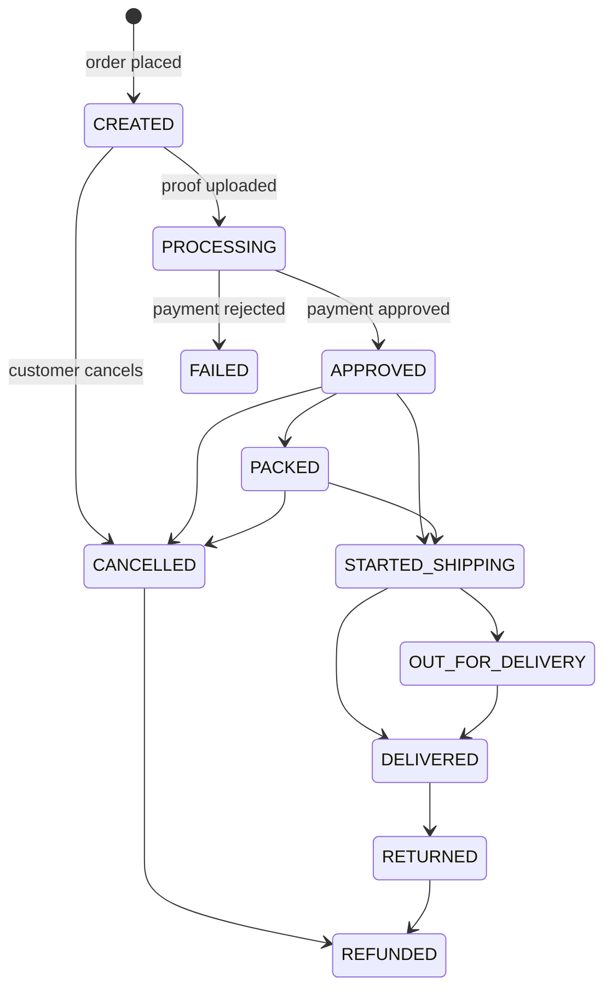

# Aesthetic Indians

[](https://github.com/thesahibnanda-max/eCommerce/actions/workflows/ci.yml)


An online store for Indian ethnic wear. Go backend, React storefront, UPI checkout, an admin console, and the whole thing ships as **one binary** with no database server to run.

```sh
cp .env.example .env    # fill in the secrets
./scripts/build.sh
./eCommerce             # API on :3000, store on :4073
```

---

## What's in it

**Storefront**
- Catalog, categories, product pages with size variants, and "you might also like".
- Search that matches as you type (`kur` finds kurtas) and tolerates typos. When nothing matches it says so, offers "Did you mean …?", and shows suggested products.
- A bag that survives sign-in: the guest bag merges into the account bag.
- Accounts with email verification by OTP, an address book (city and state filled in from the pincode), and order history.

**Checkout and orders**
- Stock is reserved when the order is placed and handed back if it's cancelled or the payment is rejected. Placing the same order twice is blocked by an idempotency key.
- UPI payment by QR, UPI ID or a "Pay with a UPI app" link. The customer uploads the UTR and a screenshot.
- An order tracker: Placed → Confirmed → Packed → Shipped → Out for delivery → Delivered. Each step shows its date, and a "Track your order" card appears once a courier link is added.
- Emails at every step that matters.

**Admin** (`/admin`)
- Review payments against the screenshot, approve or reject them, move orders along, and add tracking.
- Read-only views of every customer, bag, product and image.
- Create and edit products, and upload images.

**Under the hood**
- **Images:** converted to AVIF on upload, with EXIF orientation applied.
- **Speed:** responses are gzipped, catalog reads are cacheable for 60 s, and order lists load their payments in one query.
- **Rate limits:** a per-IP token bucket for each route group (auth, OTP, cart, admin and so on).
- **Email:** SMTP senders take turns (round robin).
- **Payments:** behind one interface, so switching from manual UPI to Instamojo is a config change.

## Stack

| | |
|---|---|
| HTTP | [Fiber v3](https://github.com/gofiber/fiber) |
| Storage | [bbolt](https://github.com/etcd-io/bbolt) for users, products, images, bags and addresses. SQLite ([modernc](https://gitlab.com/cznic/sqlite), no cgo) + [sqlc](https://sqlc.dev) for orders and payments |
| Search | [bleve](https://github.com/blevesearch/bleve) |
| Jobs | [goqite](https://github.com/maragu/goqite), used to poll Instamojo payments |
| Frontend | React 19, TanStack Query, zustand, Vite. Initial JS is held under 150 KB gzipped by a build check |

All data sits in `data/` as plain files. Back it up by copying the folder.

## How it fits together



`main.go` starts both servers from one process. `go generate ./frontend` builds the React app into `frontend/staticFiles`, which the Go binary embeds.

When `PORT` is set, the two ports become one: a single server on `$PORT` sends `/v1/*` to the API and everything else to the storefront. The browser then calls the API on its own origin, and the real client IP is read from `CF-Connecting-IP`, `True-Client-IP` or the first `X-Forwarded-For` entry, so rate limits apply per customer.

## Setup

You need Go 1.26 and Node 24.

### Secrets

Secrets live in `.env`. `config.yaml` refers to them as `${NAME}`, and they're filled in at startup by `utils.ReadParametrisedYAML`.

| Variable | What it is |
|---|---|
| `DATA_DIR` | Where the databases and images are stored. `data` locally, your disk's mount path in production |
| `STORE_URL` | Public address of the store, used in email links. `http://localhost:4073` locally |
| `TOKEN_SECRET` | Signs access tokens. At least 32 bytes |
| `ADMIN_KEY` | Unlocks `/admin` and the admin API |
| `SMTP_SENDER_N_EMAIL`, `SMTP_SENDER_N_USERNAME`, `SMTP_SENDER_N_PASSWORD` | Address, login and app password for mail senders 1 and 2 |
| `INSTAMOJO_CLIENT_ID`, `INSTAMOJO_CLIENT_SECRET`, `INSTAMOJO_PRIVATE_SALT` | Only used when the provider is `INSTAMOJO`. Leave them empty otherwise |

Variables already set in the environment win over `.env`. If one is missing entirely, the app refuses to start and names it.

### Config

Everything else is in `backend/package/dependency_injection/config.yaml`:
- store name and contact details
- shipping policy (free from ₹999, otherwise ₹79)
- ports and storage paths
- SMTP senders
- OTP rules
- rate limits
- payment provider

### Develop

```sh
go generate ./frontend   # build the storefront once
go run .
```

For hot reload on the storefront, run `npm run dev` in `frontend/web` next to `go run .`.

## Deploy on Render

Create a **Web Service** from this repo on the Go runtime.

| Setting | Value |
|---|---|
| Build command | `if ! command -v npm >/dev/null 2>&1; then curl -fsSL https://nodejs.org/dist/v24.21.0/node-v24.21.0-linux-x64.tar.xz \| tar -xJ && export PATH="$PWD/node-v24.21.0-linux-x64/bin:$PATH"; fi && go generate ./frontend && go build -tags netgo -ldflags '-s -w' -o app .` |
| Start command | `./app` |
| Environment | Every variable in `.env.example`, plus `PORT=10000`. Set `STORE_URL` to your Render URL and `DATA_DIR` to the disk's mount path |
| Disk | Mount path `/opt/render/project/src/data`, the same as `DATA_DIR`. Needs a paid instance; without it, every deploy wipes the store |

With `PORT` set, the app serves the store and the API on that one port.

### Continuous deploy

Every push to `master` runs the tests, and if they pass, GitHub Actions triggers a Render deploy. A red commit never ships. To wire it up:

1. In Render, open the service → **Settings** → copy the **Deploy Hook** URL.
2. Save it as a repo secret: `gh secret set RENDER_DEPLOY_HOOK_URL` (paste the URL when asked).
3. In Render, set **Auto-Deploy** to **Off**, so the hook is the only thing that deploys.

Without the secret, the deploy step is skipped with a warning and CI stays green.

## Checkout, step by step

1. Bag → Checkout. Pick or add an address.
2. **Place order.** Stock comes off and the bag is emptied.
3. The order page shows the amount, the UPI QR, the UPI ID and an app link.
4. The customer pays, then uploads the UTR and a screenshot. The order moves to "Checking payment".
5. You approve or reject in `/admin`, and the customer gets an email. Their page updates on its own.

Customers can cancel until they upload proof. UPI orders don't expire: a placed order holds its stock until you act on it.

## Order lifecycle



The diagram leaves out a few side states:
- **DITCHED:** an unpaid order that was abandoned.
- **ON_HOLD:** an order parked for review.
- A late payment on a closed order doesn't reopen it. The order gets a "refund needed" flag instead.

## Admin

Open `/admin` and paste the admin key. It's kept in that browser tab only.

| Action | Order becomes | Stock | Customer gets |
|---|---|---|---|
| Approve payment | Confirmed | — | Payment received |
| Reject payment | Payment failed | Returned | Payment not confirmed, with your note |
| Mark packed / shipped / out for delivery / delivered | That step | — | Matching email, with tracking once shipped |
| Add tracking | — | — | "Track your order" on their order page |
| Cancel | Cancelled | Returned | Cancelled |
| Refund | Refunded | — | Refunded |

Only the moves allowed from the current status are shown as buttons.

## API

Everything is under `/v1` and returns JSON. Customer routes take `Authorization: Bearer <token>`, and admin routes take `X-Admin-Key`.

| Area | Routes |
|---|---|
| Users | `POST /users/signup` `/login` `/token/refresh` `/email/validation` `/email/validate` · `GET /users/me` |
| Catalog | `GET /products` `/products/search` `/products/categories` `/products/:id` `/products/:id/recommendations` `/products/sku/:sku` |
| Bag | `GET` `DELETE /cart` · `POST /cart/items` `/cart/merge` · `PUT` `DELETE /cart/items/:variantID` |
| Addresses | `GET` `POST /addresses` · `PUT` `DELETE /addresses/:id` · `POST /addresses/:id/default` |
| Orders | `GET /checkout/quote` · `GET` `POST /orders` · `GET /orders/:id` · `POST /orders/:id/payment-proof` `/cancel` `/pay` |
| Payments | `POST /payments/webhook` · `GET /payments/redirect` |
| Admin | `/admin/overview` `users` `carts` `products` `images` `orders` `payments`, plus order transition and tracking, payment proof and decision |

The full route table is in `backend/package/router`.

## Payment providers

Set `payments.provider` in config:

- **`SELF_UPI`** (default): customers pay your UPI ID and you confirm by hand, as above. The QR and UPI ID come from `backend/package/clients/self_upi/self_upi.json`.
- **`INSTAMOJO`**: hosted checkout. Payments confirm themselves through the webhook, and a background job keeps polling until the payment settles or the window closes. Fill in the three `INSTAMOJO_*` secrets.

## Tests

```sh
go test -race ./...                     # backend, end to end through the HTTP layer
cd frontend/web && npm test             # storefront
npm run typecheck && npm run lint       # in frontend/web
```

CI runs all of it on every push to `master`, then deploys to Render if everything passed.

## Layout

```
main.go                     starts the API and the storefront server
backend/package/
  router, handler           routes and HTTP handlers
  services/                 business logic: users, products, carts, orders, admin
  repository/               bbolt and SQLite stores
  payment_gateway/          Gateway interface: self UPI and Instamojo
  clients/                  Instamojo and UPI clients
  dependency_injection/     wiring and config.yaml
frontend/web                React app
frontend/                   Go server that embeds and serves the built app
scripts/                    build and pincode refresh
data/                       runtime data, not committed
```

## Refresh pincodes

```sh
UPDATE_PINCODES=1 go test -count=1 -run Test_Update ./scripts/update_pincodes
```
